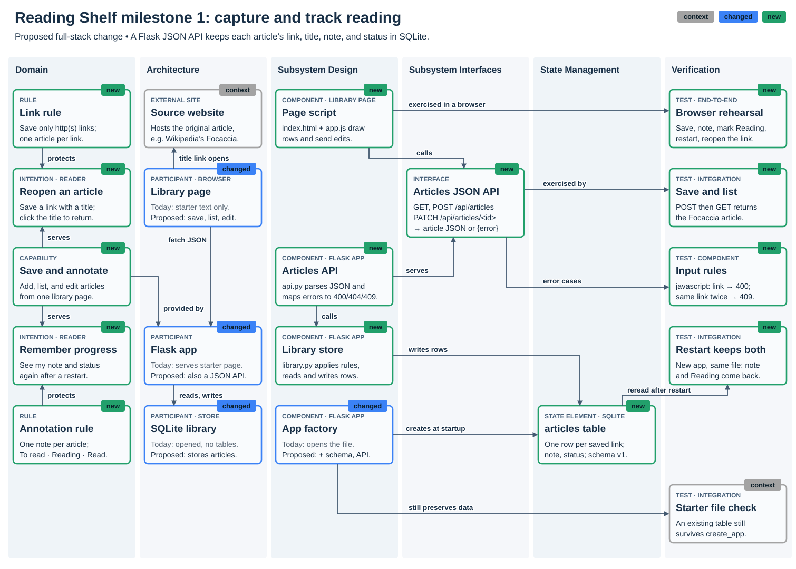
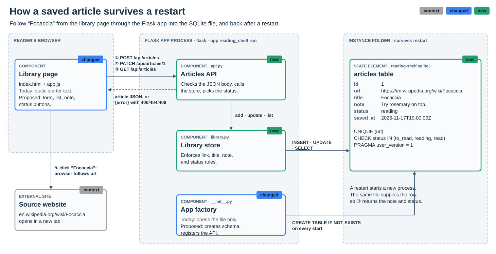
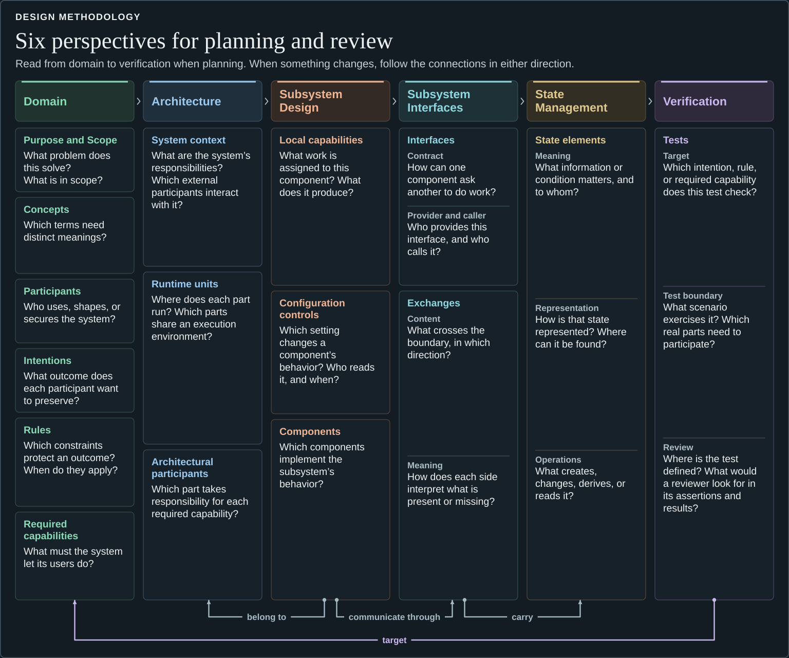

# Continuous Assurance

Continuous Assurance is a toolkit for teams that design, build, and deploy software with coding assistants. With every change, your team decides what people should be able to rely on and what evidence would give you confidence that the software behaves as intended. The two skills in this repository help you work through those questions with a coding assistant.

## Propose a change or explore a system

**Design Proposal** helps you decide how a system should change before implementation. Its overview diagram starts with the outcome a user needs and shows which domain rules and capabilities the change affects. It connects those capabilities to the parts of the architecture responsible for them, shows how those responsibilities would change, and identifies a check that would distinguish the proposed behavior from what happens today. A second diagram follows one scenario through the components, showing what they exchange and which component makes each decision. You can question a tradeoff or revise the design before asking the assistant to implement it.

**Explore Design** helps you understand how a system works today. Ask what a caller sees when an operation fails or who depends on a particular rule. The assistant traces the behavior through the code, tests, and documentation. It cites the evidence for its answer and points out which questions remain open.

## Examples

### Reading Shelf

A developer asked for a full-stack application where readers could save articles, keep notes, and track their reading progress. Claude Code used the **Design Proposal** skill to plan how to build it.

```text
I would like to develop a full-stack application called Reading Shelf. When I
come across an article I want to read later, I’d like to paste in the link,
give it a title, and save it. Then, when I have time to read, I can open my
library and click the title to get back to the original article.

I often forget why I saved something, so I’d like a place to leave myself a
note. One note per article is plenty, as long as I can edit it later. I’d also
like to keep track of what I’ve started reading. I think “To read”, “Reading”,
and “Read” would cover it. If I leave a note and mark an article “Reading”,
I’d expect to see that note and status again after I restart the app.

I’d like to use Flask to serve the page and a JSON API. Plain HTML, CSS, and
JavaScript are fine for the page, and I’d like to keep my library in a local
SQLite database.

Give me a design proposal [use /ca-design-proposal].
```

#### Design overview

Claude Code’s high-level design traces Reading Shelf’s domain requirements through the proposed architecture to the tests that would verify the application’s behavior.



#### Component collaboration

For the detailed design, Claude Code showed how the library page calls the Flask API, which uses the library store to save articles to SQLite and read them back.



## The design method

Both skills use the six perspectives shown below. They give developers, architects, and reviewers a shared vocabulary for following a user’s requirement through the system to a test that checks it. To better understand the design methodology, read [Enforcing Design Methodology with Coding Assistants](https://hirendra-rathor.github.io/articles/enforcing-design-methodology-with-coding-assistants/).



## Install the skills

Extract the skills ZIP, or use the folders under `distribution/skills/` in a clone of this repository. You can install `ca-design-proposal`, `ca-explore-design`, or both. Create your assistant’s skills directory if needed, then copy each whole skill folder into it, including hidden files. [Download the skills ZIP](https://github.com/hirendra-rathor/continuous-assurance/releases/latest/download/ca-skills.zip)

| Assistant | Personal skills directory | Invoke in a new session |
| --- | --- | --- |
| Codex | `~/.codex/skills/` or `$CODEX_HOME/skills/` for a custom profile | `$ca-design-proposal` or `$ca-explore-design` |
| Claude Code | `~/.claude/skills/` or `$CLAUDE_CONFIG_DIR/skills/` for a custom profile | `/ca-design-proposal` or `/ca-explore-design` |

## Try the skills on different codebases

| Repository | Description | Walkthrough |
| --- | --- | --- |
| [Reading Shelf](https://github.com/hirendra-rathor/example-reading-shelf) | A **full-stack web application** where readers save article links, add notes, and organize articles into collections. | [Reading Shelf walkthrough](https://hirendra-rathor.github.io/examples/reading-shelf/) |
| [Movie Seats](https://github.com/hirendra-rathor/example-movie-seats) | A **booking service** whose JSON API lets clients hold a group of seats for a screening, then confirm or cancel the reservation. | [Movie Seats walkthrough](https://hirendra-rathor.github.io/examples/movie-seats/) |
| [Retry Kit](https://github.com/hirendra-rathor/example-retry-kit) | A **Python library** that lets callers choose which exceptions trigger a retry, how many attempts to allow, and how long to wait between attempts. | [Retry Kit walkthrough](https://hirendra-rathor.github.io/examples/retry-kit/) |

## License

The skills are distributed under the MIT License. See `LICENSE`.
