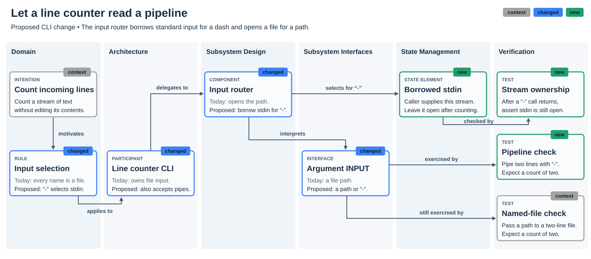
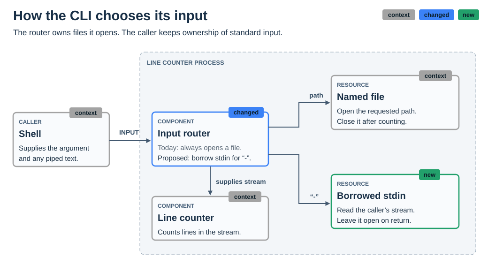

# Proposal diagram examples

Let callers pass `-` to count lines in piped text while preserving the existing behavior for named files.

## Expanded summary

The intention is to learn how many lines a text contains without altering it.
The input router currently treats every argument as a file path. Interpreting
`-` as standard input lets the same counter read a pipeline. A two-line pipe
and a two-line named file should each produce a count of two. Both counts
could be correct even if the router closed the caller's stream.

The image follows input selection inside the CLI. In a full overview, name
the shell that supplies the stream alongside the CLI that consumes it. The
input-selection rule constrains the choice of source by reserving `-` for
standard input. The borrowing rule protects the caller's control of the
stream by requiring it to stay open after counting.

## Stream ownership

After counting two lines from `-`, what should happen when the caller next
reads from the same stream?

| Who closes the supplied stream? | What does the caller observe after the count? |
| --- | --- |
| The router closes every input it counts. | The next read fails because the stream is closed. |
| The router borrows the stream and leaves it open. | The next read reports end of input. The caller can still close the stream itself. |

I recommend borrowing standard input because the caller supplied it and
controls its lifetime. The router still closes a named file it opens itself.

## Implementation collaboration

The same counter can read either stream. The router chooses the source and closes a file it opens. A focused test can supply a readable stream for `-`, call the router and confirm that the stream remains open afterward. The author would run both this check and the CLI checks to verify the proposal's separate promises.

Use the [diagram guide](diagrams.md) for layout and rendering. Choose subjects from the system under review and give each relationship a meaning the reader can verify.
